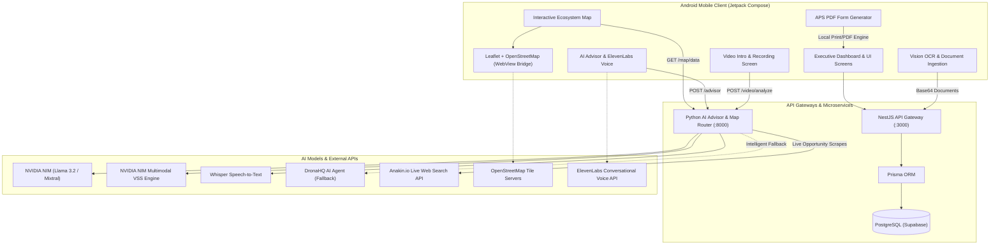

# Voraus AI 🚀
### *The Next-Generation AI Ecosystem for International Students in Germany*
*(Formerly EduJourney Germany)*

[-3DDC84?style=for-the-badge&logo=android&logoColor=white)](https://developer.android.com/)
[](https://kotlinlang.org/)
[](https://fastapi.tiangolo.com/)
[](https://nestjs.com/)
[](https://build.nvidia.com/)
[-3ECF8E?style=for-the-badge&logo=supabase&logoColor=white)](https://supabase.com/)
[](LICENSE)

---

## 📖 Overview

Navigating higher education, vocational training (*Ausbildung*), and bureaucratic relocation to Germany is notoriously complex. International applicants face intricate hurdles: strict APS certificate verification, Bavarian formula grade equivalency conversions, visa appointments, €11,904 blocked account thresholds, accommodation shortages, and finding part-time student employment (*Werkstudent* / *Minijob*).

**Voraus AI** is an all-in-one, AI-native platform designed to simplify every step of this journey. Powered by **NVIDIA NIM multimodal models**, **FastAPI**, **NestJS**, and a native **Jetpack Compose Android application**, Voraus AI delivers real-time guidance, automated document intelligence, live city mapping, and personalized university admissions tracking.

---

## 🎬 Application Demo Video

Experience Voraus AI in action! The full walkthrough demonstrates user authentication, video splash screen, interactive Berlin mapping, multimodal AI video analysis, APS certificate generation, and dynamic AI advising.

<p align="center">
  <a href="Educaro%20APP%20Demo%20Vedio.mp4" title="Click to watch full HD demo video">
    
  </a>
  <br />
  <sub>🎬 <b>Live Walkthrough Preview</b> (Click the preview above or <a href="Educaro%20APP%20Demo%20Vedio.mp4"><b>click here to watch/download full HD video</b></a> • 3m 14s)</sub>
</p>

| Milestone | Timestamp | Highlights in Demo |
|---|---|---|
| 🎬 **Splash & Authentication** | `0:00 - 0:30` | Looping video splash screen, secure registration, and goal selection |
| 📄 **Document Upload & OCR** | `0:30 - 1:15` | Automated extraction of passport & academic credentials via NVIDIA Vision |
| 🤖 **Dual-Engine AI Advisor** | `1:15 - 2:00` | Conversational advisor with live university recommendations & voice agent |
| 🗺️ **Interactive Berlin Map** | `2:00 - 2:40` | Live student ecosystem with 40+ curated minijobs, Indian eateries & welfare |
| 📝 **APS & Deadlines Engine** | `2:40 - 3:14` | One-click APS Form PDF generator and application milestone tracker |

> 💡 **Direct Video File**: The raw video is hosted directly in this repository at [`Educaro APP Demo Vedio.mp4`](Educaro%20APP%20Demo%20Vedio.mp4) (H.264 / AAC • 20.4 MB).

---

## 🌟 Key Features

### 1. 🗺️ Live Berlin Student & Opportunity Ecosystem (OpenStreetMap)
Natively rendered through an optimized Android WebView bridge paired with Leaflet.js and Marker Clustering:
- **40+ Curated, Authentic Berlin Locations**:
  - 🍛 **Authentic Indian Cuisine & Groceries**: AMRIT Mitte, AMRIT Kreuzberg, Papadam, Mela Schöneberg, Khushi, Chutnify Neukölln, Saravanaa Bhavan, Shivani, Agra, and Vedis (featuring live ratings, addresses, and specialties).
  - 💼 **English-Speaking Student Jobs (*Werkstudent* / *Minijobs*)**: Zalando SE Tech Hub, Delivery Hero HQ, N26 Mobile Bank, HelloFresh, Amazon Development Center, Flink Mitte, Getir/Gorillas, Tier Mobility, SoundCloud, Babbel, Wayfair, and Personio (with wage ranges from **€14.50 to €19.00/hr**, role specifications, and shift flexibility).
  - 🎓 **Top Universities & Institutes**: TU Berlin (TU9), HU Berlin, FU Berlin, HTW Berlin, HWR Berlin, Charité Universitätsmedizin, ESMT Berlin, SRH Berlin, IU International, and BHT Berlin.
  - 🤝 **Diaspora Support & Student Welfare**: Indian Association Berlin (IAB), Indian Students Association (ISA TU Berlin), Embassy of India & Tagore Centre, Friends of India, Telugu Association (TABB), Tamil Sangam Berlin, Gurudwara Sri Guru Singh Sabha (*providing free daily Langar & emergency temporary shelter*), and Sri Ganesha Temple.
- **Dynamic UX**:
  - Client-side keyword search with instant pin highlighting.
  - Interactive filter chips with live counter badges (`All 40`, `💼 Jobs 12`, `🍛 Restaurants 10`, `🎓 Universities 10`, `🤝 Communities 8`).
  - Floating bottom popup cards with direct `Directions ↗` opening native Google Maps navigation and `View more →` official portal links.
  - **Zero-Blank Offline Guarantee**: Bundled offline fallback dataset guarantees zero visual lag even without network connectivity.

---

### 2. 🎥 Multimodal Video Introduction & AI Video Analysis (VSS)
- **NVIDIA VSS Multimodal Evaluation**: Evaluates applicant self-introduction videos across facial posture, camera eye contact, speech delivery, clarity, and German academic/visa interview readiness.
- **Whisper Speech-to-Text (STT)**: Decodes spoken audio track directly on the server to analyze language fluency and motivation.
- **Comprehensive Scorecard (0–100)**: Generates detailed metrics for Confidence, Fluency, and Visa Readiness, accompanied by qualitative strengths and targeted interview recommendations.
- **Device & Cloud Hybrid Architecture**: Employs smart candidate URL reachability (localhost, `10.0.2.2` Android emulator, LAN IP) with on-device direct NVIDIA NIM fallback.

---

### 3. 🤖 Dual-Engine AI Advisor & Real-Time Web Scraper
- **Primary AI Engine**: **NVIDIA NIM** (Meta Llama 3.2 Vision / Mixtral) grounded in 45+ German academic datasets.
- **Resilient Fallback**: Automatic failover to **DronaHQ AI Agent** if Nvidia hits rate limits or encounters out-of-distribution queries (`UNKNOWN_QUERY`).
- **Structured Recommendations**: Automated extraction of university shortlists formatted in strict delimiter blocks (`[UNIVERSITY_RECOMMENDATIONS]...[/UNIVERSITY_RECOMMENDATIONS]`).
- **Live Opportunity Syndication**: Direct integration with **Anakin.io Search API** (`POST /map/sync-anakin`) for scraping latest student job postings and events.
- **Conversational Voice**: Integrated **ElevenLabs Conversational AI Agent** for interactive voice counseling.

---

### 4. 📝 Automated APS Certificate Generator & PDF Exporter
- Streamlines the mandatory **APS India** (Akademische Prüfstelle) verification process.
- Automatically aggregates applicant personal details, high school board grades, bachelor's degree credentials, and transaction references.
- **One-Tap PDF Export**: Generates an authentic, print-ready APS Application Form PDF with clean formatting ready for physical consulate submission.

---

### 5. 📄 Vision OCR & Document Intelligence
- **NVIDIA Vision OCR Pipeline**: High-accuracy parsing of Passports (Full Name, DoB, Passport Number, Nationality), Degree Certificates, Transcripts, and English/German Language Certifications (IELTS, TOEFL, TestDaF, Goethe).
- **Automated Bavarian Formula Conversion**: Converts Indian CGPA/Percentages (10-point / 100-point scales) into official German grades (1.0–4.0 scale):
  $$\text{German Grade} = 1 + 3 \times \frac{N_{\max} - N_{\text{student}}}{N_{\max} - N_{\min}}$$
- **Dynamic Document Status Tracking**: Real-time checklist monitoring across `Verified`, `Needs Review`, and `Pending`.

---

### 6. 📅 Deadlines & Reminders Timeline Tracker
- Dedicated visual timeline for major intake cycles (Winter Semester - July 15, Summer Semester - January 15).
- Live milestones tracking Uni-Assist submissions, APS certificate processing, blocked account funding, and German embassy visa appointments.

---

### 7. 💶 Finance, Visa & Blocked Account Navigator
- **Blocked Account Estimator**: Accurate guidance for meeting the German Federal Foreign Office threshold (**€11,904/year** minimum).
- **Health Insurance Advisor**: Comparison between statutory public health funds (*Techniker Krankenkasse (TK)*, *Barmer*) and private expat insurance (*Expatrio*, *Coracle*, *Mawista*).
- **Consulate Checklists**: Step-by-step documentation bundles for VFS Indian visa centers.

---

### 8. 🎨 Executive Jetpack Compose UI/UX
- Material 3 design system with an executive navy-blue color palette and subtle micro-animations.
- High-definition video splash screen (`splash_bg_video.mp4`) that loops gracefully and responds to user interaction.
- Spacious 82dp floating navigation dock with animated capsule state indicators.

---

## 🏗️ System Architecture



---

## 💻 Tech Stack

| Domain | Technology / Library | Description |
|---|---|---|
| **Mobile App** | Kotlin, Jetpack Compose, Material 3 | Declarative modern Android UI framework |
| **Architecture** | MVVM, Coroutines, StateFlow, Navigation Compose | Robust, reactive mobile architecture |
| **Networking** | Retrofit 2, OkHttp 3, Gson | Resilient RESTful API client with configurable timeouts |
| **Map Rendering** | Leaflet.js 1.9.4, MarkerCluster, OpenStreetMap | Lightweight, GPU-accelerated webview mapping |
| **AI / ML Backend** | Python 3.12, FastAPI, Uvicorn, Pydantic | Asynchronous microservices routing |
| **Multimodal Video** | NVIDIA NIM, Whisper STT, OpenCV, imageio-ffmpeg | Temporal frame extraction & confidence scoring |
| **Language Models** | Meta Llama 3.2 Vision, Mixtral 8x7B | Advanced conversational reasoning & document parsing |
| **Failover AI** | DronaHQ Agent API | Failover agent with token-budget protections |
| **Voice AI** | ElevenLabs Conversational Voice SDK | Low-latency voice interaction |
| **Gateway & ORM** | NestJS, TypeScript, Prisma ORM | Enterprise TypeScript backend |
| **Database** | PostgreSQL on Supabase | Secure cloud relational persistence & auth |
| **Knowledge Base** | 45+ Curated CSV Datasets | German higher education matrices & visa guidelines |

---

## 📂 Repository Structure

```
Voraus-AI/
├── advisor/                           # Python FastAPI AI Advisor & Video VSS Backend
│   ├── advisor_router.py              # Endpoints: /advisor, /map/data, /video/analyze, Anakin sync
│   ├── video_vss_agent.py             # Multimodal video analysis: OpenCV frames + Whisper STT + NIM
│   ├── load_kb.py                     # German knowledge base indexer
│   ├── requirements.txt               # Python package dependencies
│   ├── supabase_schema.sql            # SQL schema definitions
│   └── prompts/                       # Nvidia & DronaHQ system prompts
├── android-app/                       # Native Android Application (Jetpack Compose)
│   ├── app/src/main/
│   │   ├── assets/
│   │   │   ├── leaflet_cluster_map.html   # Leaflet OpenStreetMap interactive map
│   │   │   ├── leaflet_heatmap.html       # Heatmap visualization layer
│   │   │   └── germany_csv/               # Bundled offline datasets (Zero-Blank guarantee)
│   │   ├── java/.../edujourneygermany/
│   │   │   ├── advisor/               # AiAdvisorScreen, ViewModels, and NVIDIA/DronaHQ APIs
│   │   │   ├── auth/                  # Splash, Login, Registration, Goal selection
│   │   │   ├── data/                  # UserProfileStore, LocalDocumentManager
│   │   │   ├── heatmap/               # HeatMapScreen (Android-to-Leaflet WebView bridge)
│   │   │   ├── navigation/            # Jetpack Compose Navigation & Floating Bottom Dock
│   │   │   ├── network/               # Retrofit client and DTO definitions
│   │   │   ├── opportunities/         # University matching & application management
│   │   │   ├── presentation/          # HomeDashboardScreen, Deadlines, Details
│   │   │   └── profile/               # VideoIntroScreen, ApsGeneratorScreen, CV Generator
│   │   └── res/raw/                   # Video assets (splash_bg_video.mp4)
├── backend/                           # NestJS Backend API Gateway
│   ├── src/
│   │   ├── ai/                        # AI controllers & chat modules
│   │   ├── applicant/                 # Student profile & onboarding management
│   │   ├── documents/                 # Document ingestion & Vision OCR service
│   │   ├── map/                       # Map synchronization endpoints
│   │   └── opportunities/             # Course recommendations & matching
│   └── prisma/                        # Prisma schema & database migrations
├── assets/                            # Visual previews & documentation media
│   ├── demo_preview.gif               # Animated mobile walkthrough demo
│   └── demo_thumbnail.png             # Video poster thumbnail
├── datasets/                          # 45+ Curated German Education & Living Cost Datasets
├── Educaro APP Demo Vedio.mp4         # Full walkthrough demonstration video of Voraus AI
└── README.md                          # Project documentation
```

---

## 🚀 Getting Started

### 1. Prerequisites
- **Android Studio** (Koala | Ladybug recommended) with Android SDK 34+.
- **Python 3.10+** with `pip` and `virtualenv`.
- **Node.js 18+** with `npm`.
- **FFmpeg** (installed or auto-resolved via `imageio-ffmpeg`).

---

### 2. Setting Up the Python AI & VSS Backend (`advisor/`)

1. Open your terminal and navigate to the `advisor/` directory:
   ```bash
   cd advisor
   ```

2. Create and activate a virtual environment:
   ```bash
   python -m venv venv
   # On Windows:
   venv\Scripts\activate
   # On macOS/Linux:
   source venv/bin/activate
   ```

3. Install required dependencies:
   ```bash
   pip install -r requirements.txt
   pip install openai-whisper opencv-python imageio-ffmpeg
   ```

4. Configure your `.env` file (see [Environment Configuration](#-environment-configuration) below).

5. Start the FastAPI development server:
   ```bash
   python -m uvicorn advisor_router:app --reload --host 0.0.0.0 --port 8000
   ```
   *The server will be available at `http://127.0.0.1:8000` with interactive Swagger docs at `http://127.0.0.1:8000/docs`.*

---

### 3. Setting Up the NestJS API Gateway (`backend/`)

1. Navigate to the `backend/` directory:
   ```bash
   cd ../backend
   ```

2. Install dependencies:
   ```bash
   npm install
   ```

3. Run database migrations:
   ```bash
   npx prisma migrate dev
   ```

4. Start the NestJS API service:
   ```bash
   npm run start:dev
   ```
   *The gateway will run at `http://localhost:3000`.*

---

### 4. Running the Android Application (`android-app/`)

1. Open Android Studio and select **Open**, then select the `android-app` folder.
2. Allow Gradle to sync and download all dependencies.
3. Configure your API base URL:
   - **Android Emulator**: Uses `http://10.0.2.2:8000` for FastAPI and `http://10.0.2.2:3000` for NestJS.
   - **Physical Device**: Update with your workstation's LAN IP address (e.g., `http://192.168.1.X:8000`).
4. Connect an Android device with Developer Mode / USB Debugging enabled, or launch an AVD.
5. Click **Run (▶)** to install and launch the application.

---

## 🔑 Environment Configuration

Create a `.env` file in the `advisor/` directory with the following variables:

```env
# NVIDIA NIM API Configuration
NVIDIA_API_KEY=nvapi-your-key-here
NVIDIA_MODEL=meta/llama-3.2-11b-vision-instruct

# DronaHQ Fallback Configuration
DRONAHQ_AGENT_URL=https://your-dronahq-agent-endpoint
DRONAHQ_API_KEY=your-dronahq-key
DRONAHQ_MODE=fallback
DRONAHQ_DAILY_CAP=30

# Anakin.io Web Extraction API
ANAKIN_API_KEY=ask_your_anakin_key

# Supabase Database Configuration
SUPABASE_URL=https://your-project.supabase.co
SUPABASE_SERVICE_KEY=your-service-role-key

# ElevenLabs Conversational Voice
ELEVENLABS_AGENT_ID=your-agent-id
```

---

## 📡 API Reference

### AI Advisor & Video VSS Endpoints (`advisor/`)

| Method | Endpoint | Description |
|---|---|---|
| `POST` | `/advisor` | Dual-engine AI advisor query returning structured university guidance |
| `POST` | `/advisor/text` | Plain text endpoint formatted for chat interfaces |
| `GET` | `/map/data?category={all\|jobs\|restaurants\|universities\|communities}` | Returns curated + scraped student ecosystem markers |
| `POST` | `/map/sync-anakin` | Triggers real-time web scrape of Berlin opportunities via Anakin.io |
| `POST` | `/map/webhook` | Webhook ingestion endpoint for external web scrapers |
| `POST` | `/video/analyze` | Multipart video upload for NVIDIA VSS + Whisper scoring analysis |
| `POST` | `/video/analyze-path` | Local video file path analysis for VSS agent |
| `GET` | `/video/analyze-sample` | Quick verification test on the bundled sample video |

---

## 🔒 Security, Privacy & GDPR Compliance

- **Document Protection**: All identity documents uploaded during onboarding are processed in strict accordance with European GDPR principles.
- **Credential Hygiene**: Sensitive keys are kept isolated in environment variables and Android `local.properties` (never committed to version control).
- **Graceful Offline Mode**: Core map datasets and guidelines remain accessible locally without transmitting telemetry when offline.

---

## 👥 Contributors

- **Harsha Vardhan** ([@D-Harsha-vardhan](https://github.com/D-Harsha-vardhan))
- **Adithya Kumar** ([@adithya-kumar](https://github.com/adithya6845))
- **Kartikey Sharma**

---

## 📄 License

This project is licensed under the [MIT License](LICENSE).
